<div align="center">



<br /><br />

<a href="mailto:tolgahanturker@hotmail.com"></a>&nbsp;
&nbsp;


</div>

<br />

```bash
togi@creator ❯ cat hakkimda.md
```

> Tekrar eden işleri **çalışan yazılıma** çeviriyorum: masaüstü otomasyonları, kurumsal güvenlik araçları ve web uygulamaları.
> Electron, Node.js ve C# ile yazıyorum; boş kalan zamanda Arduino kurcalıyor, 3D yazıcıda lamba basıyorum.
> Kısacası: **build → create → inspire.**

<br />



<br />

```bash
togi@creator ❯ ls ~/projeler --one-cikan
```



<br />

```bash
togi@creator ❯ ls ~/atolye
```



<br />

```bash
togi@creator ❯ cat not.txt
```

```text
Projelerin çoğu kurumsal ve özel (private) repolarda duruyor.
Merak ettiğin bir şey varsa e-posta at; demo ya da kısa bir tur ayarlarız.
```

<br />



<div align="center">
<sub>© 2026 <b>TOGI</b> · Tolgahan Türker · İstanbul · görseller <code>tools/</code> içindeki üreticiyle çizildi</sub>
</div>
